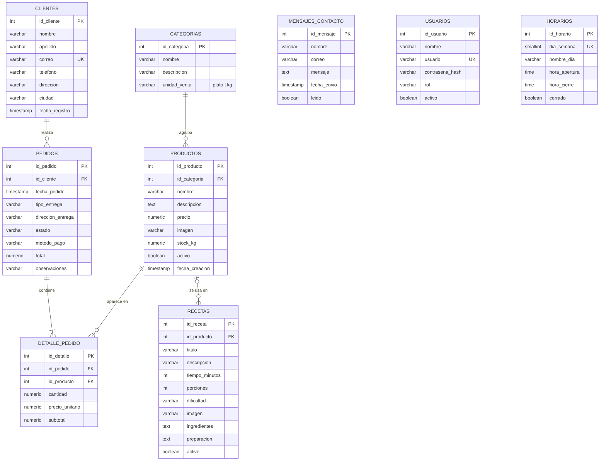

# Beef — Página web para una carnicería y asador

Proyecto de etapa productiva de **Osman Samir Pacho Vargas**
Técnico Laboral, Auxiliar en Sistemas — Politécnico Superior de Occidente (2026)

Beef es una página web para un negocio que vende **platos a la parrilla** y **cortes de carne por kilo**. Los clientes pueden ver el menú, consultar recetas y horarios, y hacer pedidos en línea que quedan guardados en una base de datos y se confirman por WhatsApp.

## Funciones

- **Carrito y pedidos:** el cliente arma su pedido, elige la entrega y la forma de pago. El precio se toma de la base de datos, no del navegador.
- **Pedidos por WhatsApp:** al confirmar, se abre WhatsApp con el resumen del pedido listo para enviar.
- **Panel de administración (`/admin`):** con usuario y contraseña, para atender pedidos, leer mensajes y cambiar precios y disponibilidad.
- **Productos en vivo:** lo que se cambia en el panel aparece en la página sin recargarla.
- **Asistente virtual con IA (Google Gemini):** responde dudas, recomienda platos y consulta el estado de un pedido.
- **Recetas y horarios:** recetas paso a paso y aviso de abierto o cerrado según la hora.
- **Secciones:** platos, cortes, recetas, horarios, promociones, nosotros, preguntas frecuentes y contacto.
- **Diseño adaptable** a celular, tablet y computador.

## Seguridad

- Protección contra peticiones de otros sitios (CSRF), inyección SQL y XSS.
- Límite de peticiones por IP y bloqueo de 15 minutos a quien acumula 10 faltas.
- Bloqueo del usuario del panel tras 5 contraseñas incorrectas.
- Campo trampa para detectar bots y registro de cada intento de ataque.
- Casilla de autorización de datos personales (Ley 1581 de 2012).
- La página se conecta a la base de datos con un usuario de permisos mínimos (`beef_app`), y las contraseñas no se guardan en el proyecto.
- `simular_ataque.py` prueba la propia página con 8 grupos de ataques (solo en `localhost`).

## Tecnologías

| Parte | Tecnología |
|---|---|
| Página | HTML, CSS y JavaScript (Swiper para los carruseles) |
| Servidor | Python con Flask y Waitress |
| Base de datos | PostgreSQL (`Beef_db`: 9 tablas y 3 vistas) |
| Inteligencia artificial | Google Gemini |

## Estructura

```
Pagina.html            Página principal
style.css              Estilos
Script.js              Carrito, pedidos, recetas, horarios y WhatsApp
asistente.js           Asistente virtual
admin.html             Panel de administración
app.py                 Servidor (API, seguridad y panel)
config.example.py      Ejemplo de configuración (sin contraseñas)
simular_ataque.py      Simulador de ataques
base_de_datos/         Scripts SQL y diagrama entidad-relación
Images/                Imágenes de la página
*.bat                  Encender, apagar y respaldar el servidor
```

## Cómo ejecutarlo

1. Instalar [Python](https://www.python.org/) y [PostgreSQL](https://www.postgresql.org/).
2. En pgAdmin, crear la base de datos `Beef_db` y ejecutar `base_de_datos/beef_db_postgresql.sql` y luego `base_de_datos/usuario_seguro_beef_app.sql` (cambiando la contraseña de `beef_app`).
3. Copiar `config.example.py` a `C:\Users\<usuario>\.beef\config.py` y escribir ahí la contraseña de `beef_app` (y, si se quiere, la clave de Gemini).
4. Instalar las dependencias: `pip install -r requirements.txt`
5. Abrir `iniciar_servidor.bat`. La página queda en <http://localhost:5000> y el panel en <http://localhost:5000/admin>.


